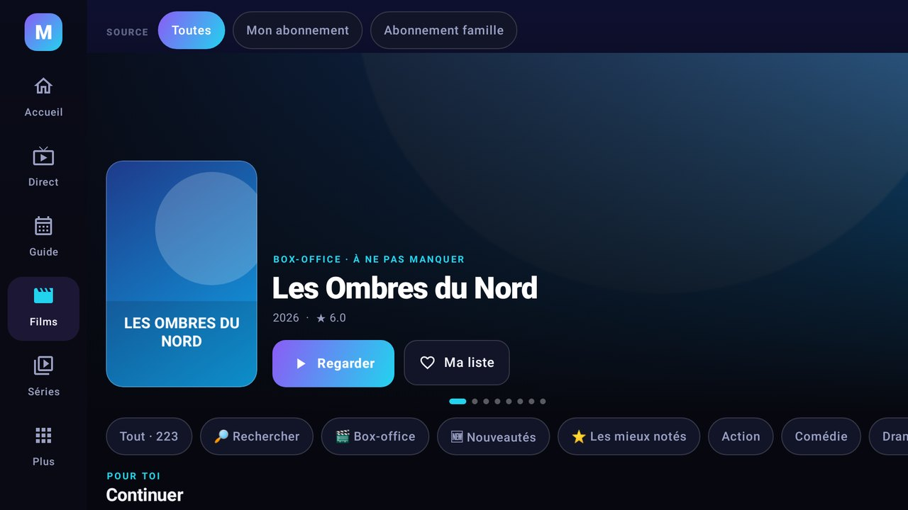
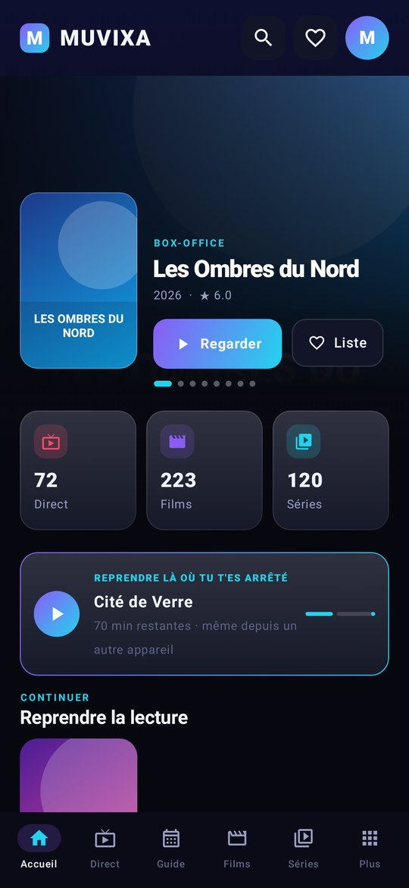
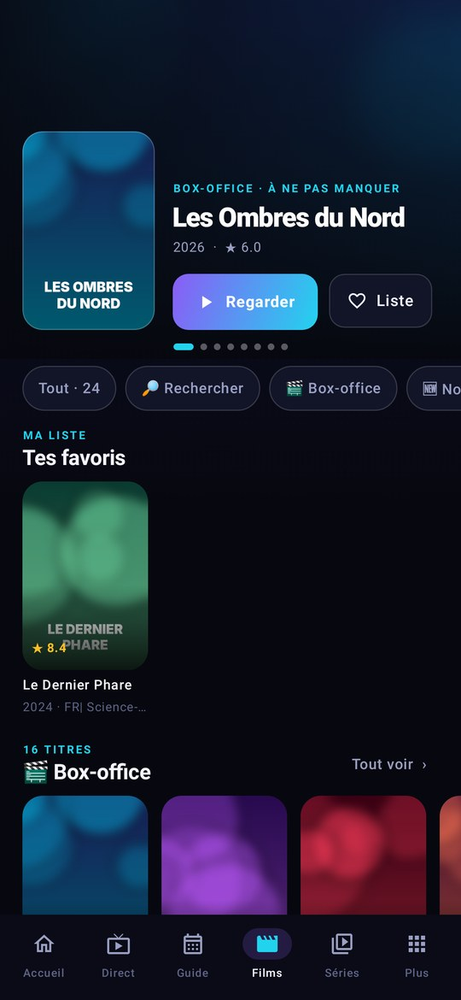
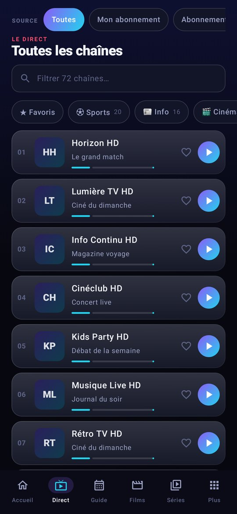
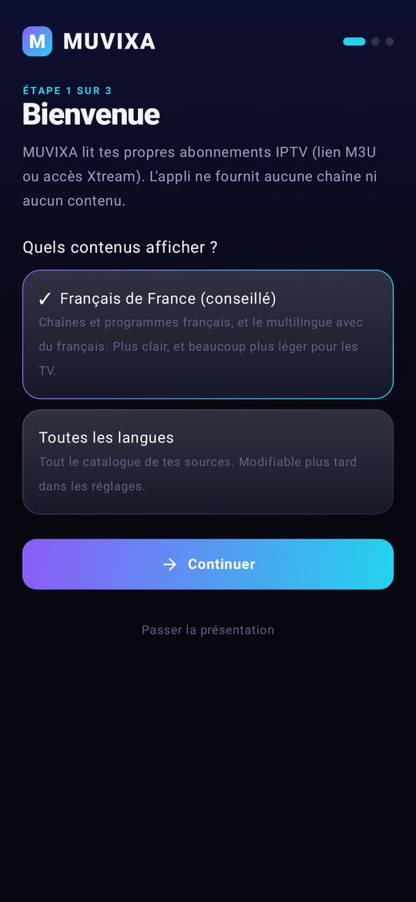
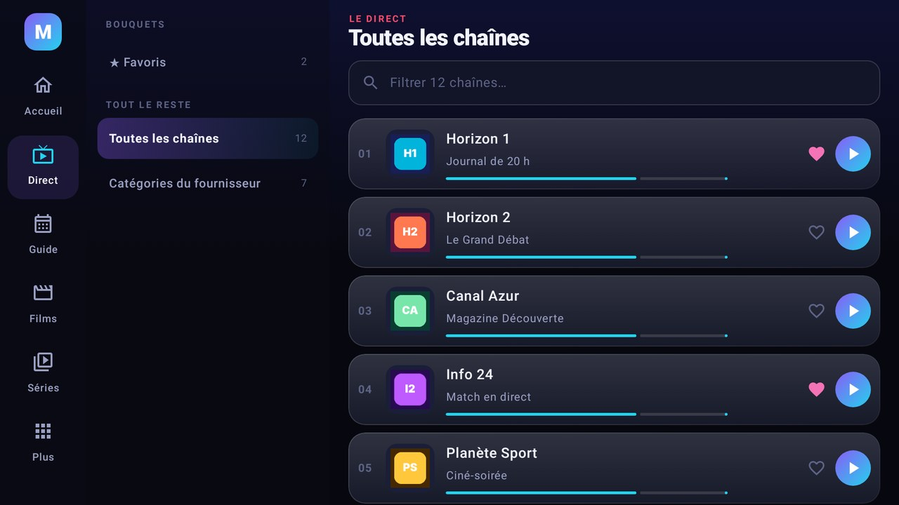
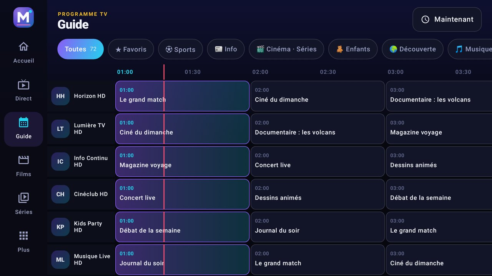
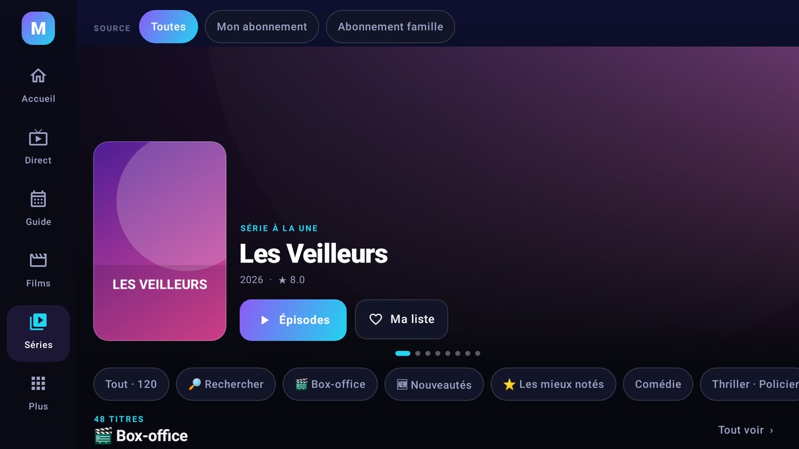
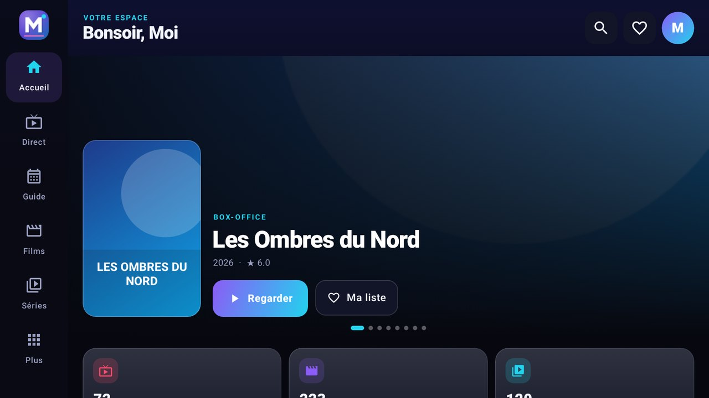

# MUVIXA

**The IPTV player designed like a set-top box: clear on your phone, comfortable on your TV.**

[🇫🇷 Français](README.md) · **🇬🇧 English**

[**Download**](#download) · [Changelog (French)](CHANGELOG.md) · [Report an issue](https://github.com/Julhid/muvixa-releases/issues/new/choose)

> [!IMPORTANT]
> MUVIXA is **only a player**. It does not provide, host or sell **any channel or content**.
> You use it with your own subscriptions (M3U link or Xtream Codes access), in compliance with broadcasting rights.

> [!NOTE]
> The interface is available in **8 languages**: French, English, Spanish, German, Italian, Portuguese, Dutch and Polish (it follows your device language, and can be changed in the settings). Content from every language of your sources can be shown; French-only mode is available in the settings.

## Contents

- [Download](#download)
- [Screenshots](#screenshots)
- [Features](#features)
- [Installation](#installation)
- [Getting started](#getting-started)
- [Privacy](#privacy)
- [FAQ](#faq)
- [Under the hood](#under-the-hood)
- [What's in this repository](#whats-in-this-repository)

## Download

Version 3.31 · Android 7.0 or later · [which file should I pick?](#installation)

## Screenshots

<table>
  <tr>
    <td align="center"> Home</td>
    <td align="center"> Movies</td>
    <td align="center"> Live TV</td>
    <td align="center"> First launch</td>
  </tr>
</table>

<table>
  <tr>
    <td align="center"> Live TV on a television</td>
    <td align="center"> Programme guide</td>
  </tr>
  <tr>
    <td align="center"> Series</td>
    <td align="center"> Home</td>
  </tr>
</table>

Screenshots taken with an entirely fictional catalogue.

## Features

### 📺 Live TV, organised like a set-top box
- **French national channels (TNT) first**, with their official numbering: type `1` on the remote for the first channel, `6` for the sixth…
- **One entry per channel**: SD, HD, FHD and 4K variants are merged, the best quality is picked and the others are kept as fallbacks.
- Themes (news, sport, movies, kids, documentaries, music), operator bundles and grouping by streaming platform.
- Your provider's original categories stay available, tucked away separately.
- Channel list and info banner without leaving the picture, zapping with the arrow keys, previous channel.
- **Pause live TV** and resume later, jump back or forward 30 seconds, **catch-up** when your provider offers it.
- **Programme guide** (XMLTV, detected automatically for Xtream), alerts for your matches.
- **Recordings**, including to a USB stick or external drive.

### 🎬 Movies and series, streaming-platform style
- Rotating hero banner and simple rows: Box office, New, Top rated, genres.
- **One card per movie or series**, even when several sources have it; if one source doesn't respond, MUVIXA moves to the next one on its own.
- **Next episode played automatically** during the end credits, seasons chained, "Skip credits".
- Running time, end time, resume where you left off, even from another device.
- **Offline**: download a movie, an episode or a whole season to watch without a connection.
- Similar suggestions at the end of a movie, series follow-up with new-episode notifications.

### ⚡ Playback that holds up
- Two engines: **ExoPlayer** (Media3) and **VLC**, with automatic fallback if one fails.
- AC3, E-AC3 and DTS audio decoded directly thanks to FFmpeg.
- Silent reconnection when the provider drops the stream, **with no repeated footage**: the stream is realigned on its internal clock.
- **Automatic live format** (MPEG-TS or HLS): MUVIXA measures smoothness and keeps the best one, source by source.
- Buffer that adapts to each channel, and support for subscriptions limited to one connection.

### 🏠 For the whole household
- **Profiles** with avatar, PIN and parental control; kids profiles with **screen time**.
- **French content by default**: other languages are hidden (configurable), which makes the app much lighter on TVs.
- **Your phone becomes a remote** (QR code), and the "On the TV" button starts a movie from the phone on the television.
- **Chromecast**, picture-in-picture, second-channel overlay, **multiview** up to 4 channels, Google Assistant.
- Favourites, profiles and playback positions synced across your devices.
- MUVIXA rows on the Android TV home screen (favourites, French TV, new releases, continue watching).
- Starts with the TV, colour themes, viewing statistics.

## Installation

| Your device | File to download |
| --- | --- |
| Recent phone or tablet, recent TV box | `MUVIXA-x.y-arm64-v8a.apk` |
| Android TV (Xiaomi, TCL, Philips…), TV stick, older device | `MUVIXA-x.y-armeabi-v7a.apk` |

> [!TIP]
> If in doubt on a TV, pick **armeabi-v7a**: it also runs on recent devices.

### On a phone or tablet
1. Download the APK from the [Download](#download) section.
2. Open the file and allow installs from your browser if Android asks.

### On an Android TV
1. Install a downloader app from the TV's Play Store (for example *Downloader*), or copy the APK to a USB stick.
2. Open this link and launch the downloaded file: `https://github.com/Julhid/muvixa-releases/raw/main/apk/MUVIXA-3.31-armeabi-v7a.apk`
3. Allow installing unknown apps for that app when the TV asks.

### Updates
MUVIXA checks for new versions on its own and offers them to you. On TV, they are even downloaded in the background: just press "Install". They install over the old one without losing your settings.

## Getting started

Three screens on first launch:

1. **Language**: French content only (recommended) or every language.
2. **Subscription**: paste the link or the message from your provider as is. MUVIXA finds the server address, username and password. On a TV, you can type everything from your phone with the QR code.
3. **Devices** (optional): one code links your phone and your TV.

Supported formats: `get.php` and `player_api.php` links (Xtream Codes), M3U / M3U8 playlists (even compressed), M3U files on the device or a USB stick.

## Privacy

- Your IPTV credentials stay **on your device**.
- Syncing between devices is **encrypted on the device** (AES-256-GCM, key derived from your code). The server only receives an unreadable blob.
- The phone remote uses an end-to-end encrypted channel.
- No ads, no trackers, no account to create.
- Diagnostic reports hide usernames and passwords, and are only sent if **you** choose to.

## FAQ

<b>Live TV stutters or cuts out</b>

Leave the live format on "Automatique" (source settings): within a few minutes MUVIXA learns the most stable format for your provider. If it persists, send the diagnostic report (Plus › Sources & réglages › Envoyer le rapport).

<b>"Too many simultaneous connections" (HTTP 509)</b>

Your subscription only allows one device at a time. Stop playback on the other device or the Chromecast: MUVIXA retries on its own as soon as the provider frees the slot.

<b>Some channels or movies are missing</b>

By default, only French and multi-language content is shown. To see everything: Plus › Catégories › "Français de France uniquement".

<b>The app closed unexpectedly</b>

On the next launch, a screen shows what went wrong. On a TV, scan the QR code with your phone, then [open an issue](https://github.com/Julhid/muvixa-releases/issues/new/choose) and paste the report.

<b>Server address blocked</b>

If MUVIXA says the address "points to 127.0.0.1", a private DNS or an ad blocker is filtering it on your device. Turn it off while adding the source, or ask your provider for another address.

## Under the hood

- Kotlin, Jetpack Compose and Material 3: a single app for phone, tablet and Android TV (full remote-control navigation).
- Playback: AndroidX Media3 (ExoPlayer, HLS, FFmpeg extension) and LibVLC.
- Networking: OkHttp; images: Coil; Chromecast: Google Cast SDK.
- Android 7.0 (API 24) minimum, 64-bit and 32-bit ARM builds.

## What's in this repository

This repository is used to **publish** MUVIXA. The source code is not included.

| Item | Purpose |
| --- | --- |
| [`apk/`](apk) | APKs of the latest version |
| [`latest.json`](latest.json) | Manifest the app reads to offer updates |
| [`CHANGELOG.md`](CHANGELOG.md) | Version history (French) |

---

© 2025-2026 Julien Hidalgo. All rights reserved. MUVIXA is not affiliated with any content provider, channel or platform.

