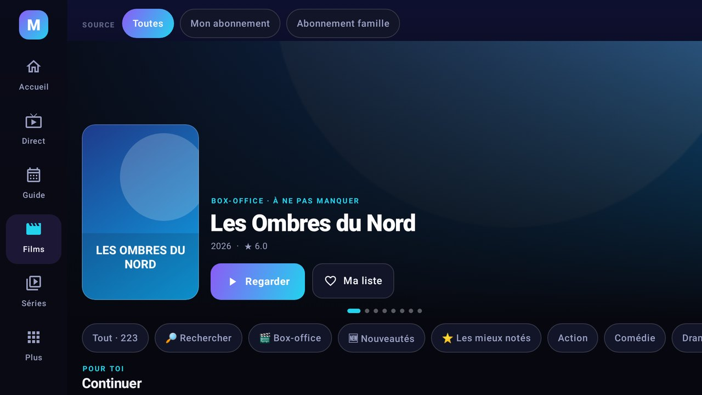
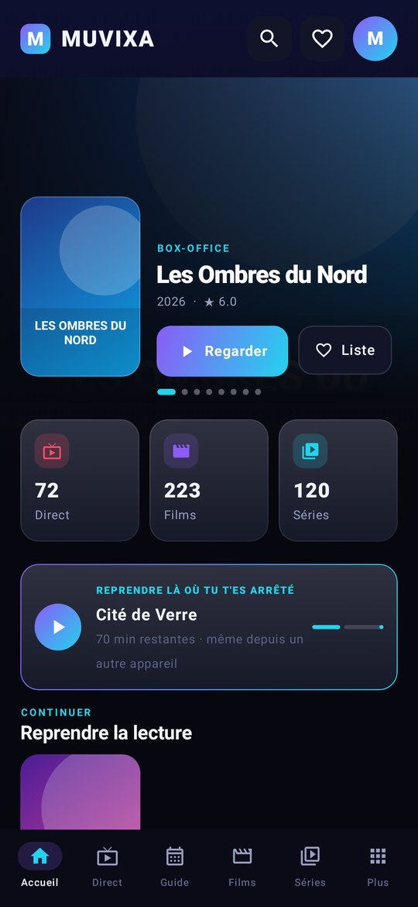
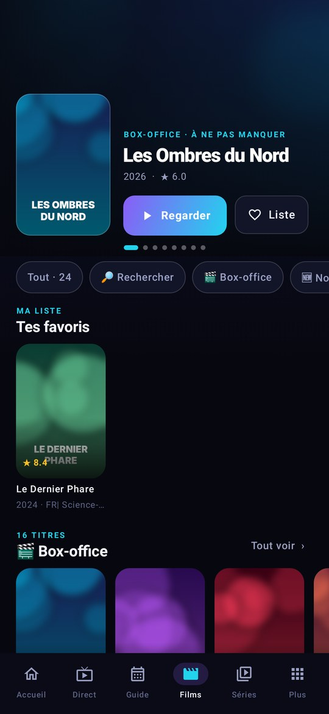
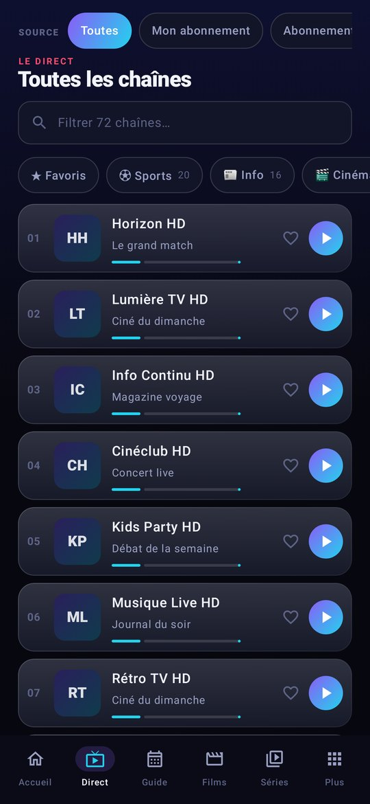
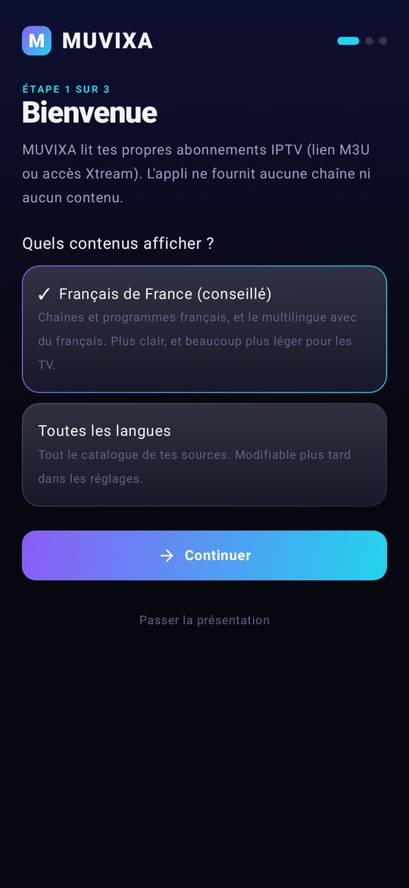
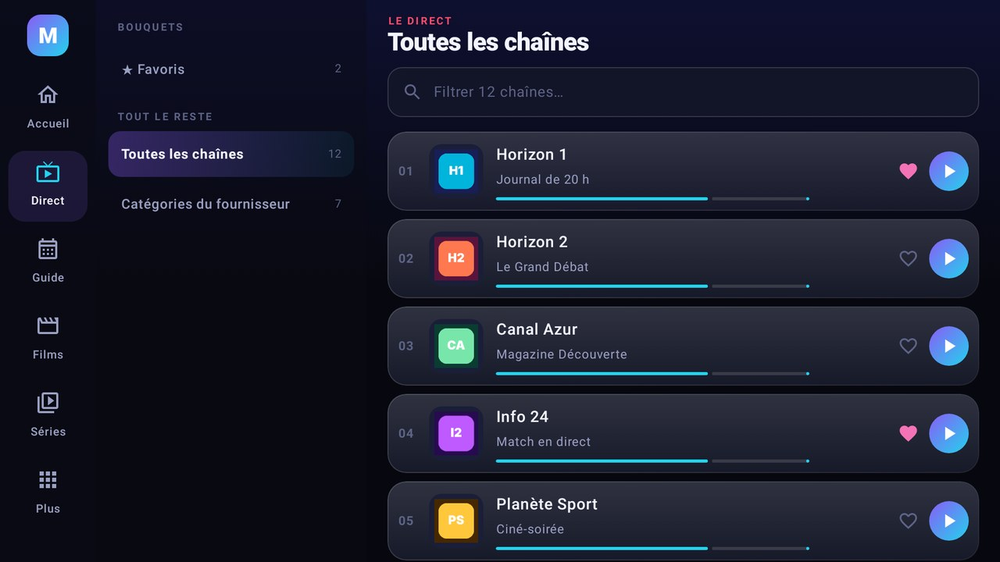
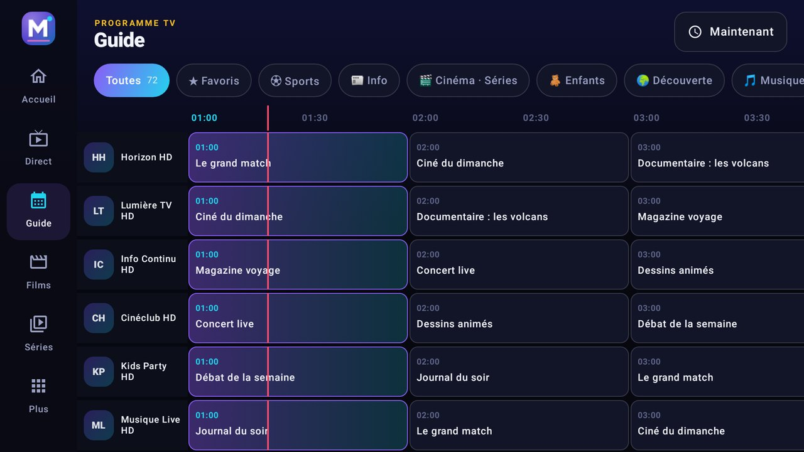
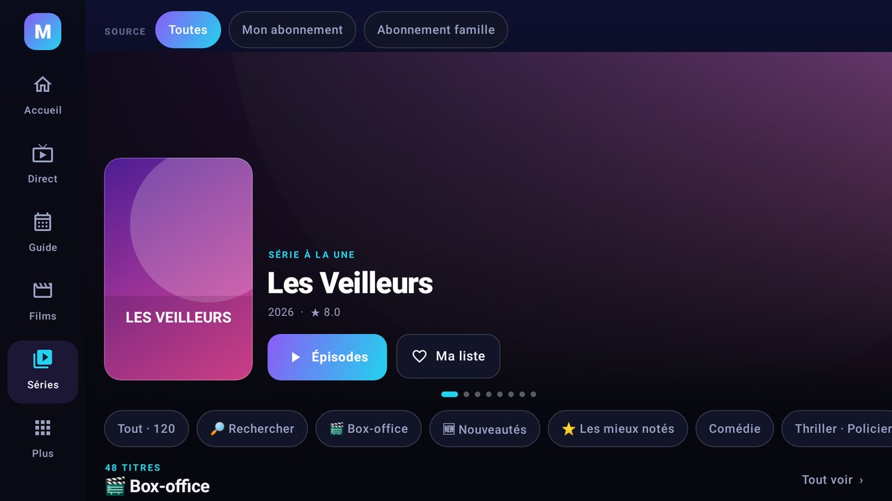
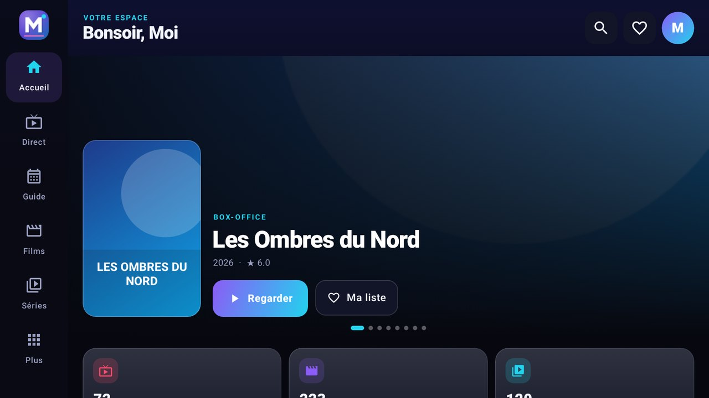

# MUVIXA

**Le lecteur IPTV pensé comme une box : clair sur téléphone, confortable sur TV.**

**🇫🇷 Français** · [🇬🇧 English](README.en.md)

[**Télécharger**](#téléchargement) · [Nouveautés](CHANGELOG.md) · [Signaler un problème](https://github.com/Julhid/muvixa-releases/issues/new/choose)

> [!IMPORTANT]
> MUVIXA est **uniquement un lecteur**. Il ne fournit, n'héberge et ne vend **aucune chaîne ni aucun contenu**.
> Tu l'utilises avec tes propres abonnements (lien M3U ou accès Xtream Codes), dans le respect des droits de diffusion.

## Sommaire

- [Téléchargement](#téléchargement)
- [Aperçu](#aperçu)
- [Fonctionnalités](#fonctionnalités)
- [Installation](#installation)
- [Premiers pas](#premiers-pas)
- [Confidentialité](#confidentialité)
- [Questions fréquentes](#questions-fréquentes)
- [Sous le capot](#sous-le-capot)
- [Contenu de ce dépôt](#contenu-de-ce-dépôt)

## Téléchargement

Version 3.29 · Android 7.0 ou plus · [quel fichier choisir ?](#installation)

## Aperçu

<table>
  <tr>
    <td align="center"> Accueil</td>
    <td align="center"> Films</td>
    <td align="center"> Direct</td>
    <td align="center"> Premier lancement</td>
  </tr>
</table>

<table>
  <tr>
    <td align="center"> Direct sur TV</td>
    <td align="center"> Guide des programmes</td>
  </tr>
  <tr>
    <td align="center"> Séries</td>
    <td align="center"> Accueil</td>
  </tr>
</table>

Captures réalisées avec un catalogue entièrement fictif.

## Fonctionnalités

### 📺 Le direct, rangé comme une box
- **TNT en premier**, avec la numérotation officielle : tape `1` sur la télécommande pour la première chaîne, `6` pour la sixième…
- **Une seule version par chaîne** : les variantes SD, HD, FHD ou 4K sont regroupées, la meilleure qualité est choisie et les autres servent de secours.
- Thèmes (info, sport, cinéma, jeunesse, découverte, musique), bouquets des opérateurs et regroupement par plateforme.
- Les catégories d'origine de ton fournisseur restent accessibles, rangées à part.
- Liste des chaînes et bandeau d'informations sans quitter l'image, zapping avec les flèches, chaîne précédente.
- **Pause du direct** et reprise en différé, recul et avance de 30 secondes, **replay** quand le fournisseur le propose.
- **Guide des programmes** (XMLTV, détecté automatiquement pour Xtream), alertes pour tes matchs.
- **Enregistrements**, y compris sur clé USB ou disque externe.

### 🎬 Films et séries, façon plateforme de streaming
- Grande affiche qui défile, rangées simples : Box-office, Nouveautés, Les mieux notés, genres.
- **Une seule fiche par film ou série**, même présents chez plusieurs sources ; si une source ne répond pas, MUVIXA passe à la suivante tout seul.
- **Épisode suivant automatique** pendant le générique, enchaînement des saisons, « Passer le générique ».
- Durée, heure de fin, reprise là où tu t'étais arrêté, même depuis un autre appareil.
- **Hors ligne** : télécharge un film, un épisode ou une saison entière pour les regarder sans connexion.
- Suggestions du même genre à la fin d'un film, suivi des séries avec notification des nouveaux épisodes.

### ⚡ Une lecture qui tient
- Deux moteurs : **ExoPlayer** (Media3) et **VLC**, avec bascule automatique si l'un échoue.
- Son AC3, E-AC3 et DTS décodé directement grâce à FFmpeg.
- Reconnexion silencieuse quand le fournisseur coupe le flux, **sans passage répété** : le flux est recalé sur son horloge interne.
- **Format du direct automatique** (MPEG-TS ou HLS) : MUVIXA mesure la fluidité et garde le meilleur, source par source.
- Mémoire tampon qui s'adapte à chaque chaîne, prise en compte des abonnements limités à une connexion.

### 🏠 Pour toute la maison
- **Profils** avec avatar, code et contrôle parental ; profils enfants avec **temps d'écran**.
- **Français de France par défaut** : contenus étrangers masqués (réglable), ce qui allège beaucoup l'appli sur les TV.
- **Le téléphone devient une télécommande** (QR code), et le bouton « Sur la TV » lance un film du téléphone sur le téléviseur.
- **Chromecast**, image dans l'image, incrustation d'une deuxième chaîne, **mosaïque** jusqu'à 4 chaînes, Assistant Google.
- Synchronisation des favoris, profils et reprises entre tes appareils.
- Rangées MUVIXA sur l'écran d'accueil d'Android TV (favoris, TNT, à l'affiche, reprise de lecture).
- Interface **en français ou en anglais** (suit la langue de l'appareil, réglable).
- Démarrage automatique avec la TV, thèmes de couleurs, statistiques de visionnage.

## Installation

| Ton appareil | Fichier à prendre |
| --- | --- |
| Téléphone ou tablette récents, box TV récente | `MUVIXA-x.y-arm64-v8a.apk` |
| Téléviseur Android (Xiaomi, TCL, Philips…), clé TV, appareil ancien | `MUVIXA-x.y-armeabi-v7a.apk` |

> [!TIP]
> En cas de doute sur une TV, prends **armeabi-v7a** : cette version fonctionne aussi sur les appareils récents.

### Sur un téléphone ou une tablette
1. Télécharge l'APK depuis la section [Téléchargement](#téléchargement).
2. Ouvre le fichier et autorise l'installation depuis ton navigateur si Android le demande.

### Sur une TV Android
1. Installe une appli de téléchargement depuis le Play Store de la TV (par exemple *Downloader*), ou copie l'APK sur une clé USB.
2. Ouvre ce lien et lance le fichier téléchargé : `https://github.com/Julhid/muvixa-releases/raw/main/apk/MUVIXA-3.29-armeabi-v7a.apk`
3. Autorise l'installation d'applis inconnues pour cette appli quand la TV le demande.

### Mises à jour
MUVIXA vérifie toute seule s'il existe une nouvelle version et te la propose. Sur TV, elle est même téléchargée en arrière-plan : il ne reste qu'à appuyer sur « Installer ». Elle s'installe par-dessus l'ancienne, sans perdre tes réglages.

## Premiers pas

Au premier lancement, trois écrans suffisent :

1. **Langue** : français de France (conseillé) ou toutes les langues.
2. **Abonnement** : colle le lien ou le message reçu de ton fournisseur, tel quel. MUVIXA y trouve l'adresse, l'identifiant et le mot de passe. Sur TV, tu peux tout saisir depuis ton téléphone grâce au QR code.
3. **Appareils** (facultatif) : un même code relie le téléphone et la TV.

Formats acceptés : liens `get.php` et `player_api.php` (Xtream Codes), playlists M3U / M3U8 (même compressées), fichiers M3U sur l'appareil ou une clé USB.

## Confidentialité

- Tes accès IPTV restent **sur ton appareil**.
- La synchronisation entre appareils est **chiffrée sur l'appareil** (AES-256-GCM, clé tirée de ton code). Le serveur ne reçoit qu'un bloc illisible.
- La télécommande par téléphone passe par un canal chiffré de bout en bout.
- Aucune publicité, aucun traceur, aucun compte à créer.
- Les rapports de diagnostic masquent identifiants et mots de passe, et ne partent que si **tu** choisis de les envoyer.

## Questions fréquentes

<b>Le direct saccade ou se coupe</b>

Laisse le format du direct sur « Automatique » (réglages de la source) : MUVIXA apprend en quelques minutes le format le plus stable chez ton fournisseur. Si ça persiste, envoie le rapport de diagnostic (Plus › Sources & réglages › Envoyer le rapport).

<b>« Trop de connexions simultanées » (HTTP 509)</b>

Ton abonnement n'accepte qu'un appareil à la fois. Ferme la lecture sur l'autre appareil ou le Chromecast : MUVIXA réessaie tout seul dès que le fournisseur libère la place.

<b>Il manque des chaînes ou des films</b>

Par défaut, seuls les contenus en français de France et multilingues sont affichés. Pour tout voir : Plus › Catégories › « Français de France uniquement ».

<b>L'appli s'est fermée</b>

Au lancement suivant, un écran affiche le détail du problème. Sur TV, scanne le QR code avec ton téléphone, puis [ouvre un ticket](https://github.com/Julhid/muvixa-releases/issues/new/choose) en y collant le rapport.

<b>Pas d'adresse de serveur trouvée / adresse bloquée</b>

Si MUVIXA indique que l'adresse « renvoie vers 127.0.0.1 », un DNS privé ou un bloqueur de publicités la filtre sur ton appareil. Désactive-le le temps de l'ajout, ou demande une autre adresse à ton fournisseur.

## Sous le capot

- Kotlin, Jetpack Compose et Material 3, une seule appli pour téléphone, tablette et Android TV (navigation à la télécommande).
- Lecture : AndroidX Media3 (ExoPlayer, HLS, extension FFmpeg) et LibVLC.
- Réseau : OkHttp ; images : Coil ; Chromecast : Google Cast SDK.
- Android 7.0 (API 24) minimum, versions ARM 64 et 32 bits.

## Contenu de ce dépôt

Ce dépôt sert à **publier** MUVIXA. Le code source n'y figure pas.

| Élément | Rôle |
| --- | --- |
| [`apk/`](apk) | Les APK de la dernière version |
| [`latest.json`](latest.json) | Manifeste lu par l'appli pour proposer les mises à jour |
| [`CHANGELOG.md`](CHANGELOG.md) | Historique des versions |

---

© 2025-2026 Julien Hidalgo. Tous droits réservés. MUVIXA n'est affilié à aucun fournisseur de contenus, chaîne ou plateforme cités.

